# Nguyễn Quang Thắng - B24CDT246
## 1. Thư viện 
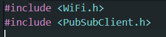
## 2. Khởi tạo kết nối với broker (broker sử dụng ở đây là emqx)
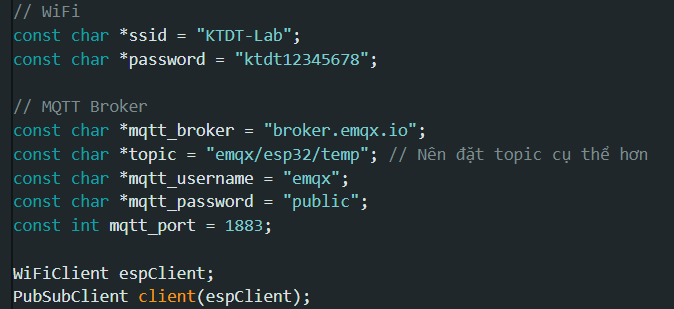
- broker emqx.io là broker public nên ko cần mật khẩu với tài khoản 
## 3. Cách đẩy dữ liệu lên broker 
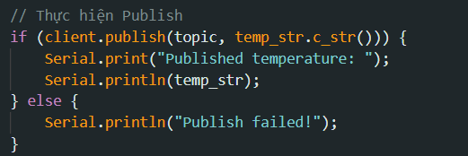
## 4. Cách tải emqx lên pc 
- truy cập vào link và tải 
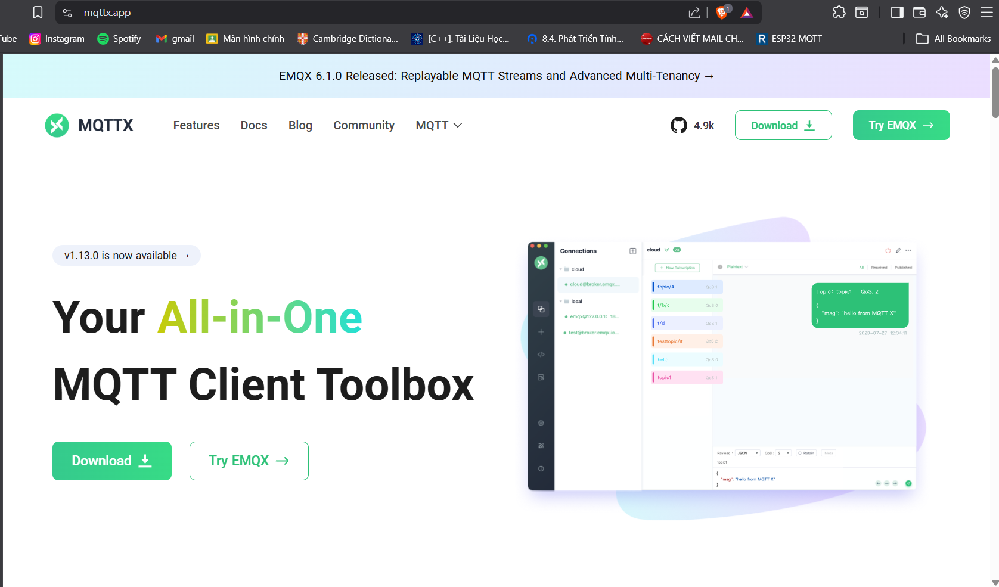
## 5. Kết nối broker với esp32
- Mở app emqx
- Bấm vào new connection
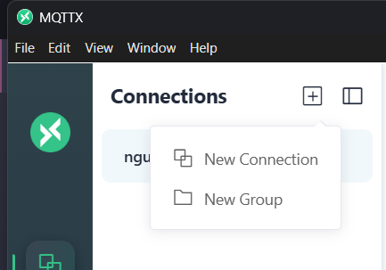
- 1 số thông tin cần thiết 
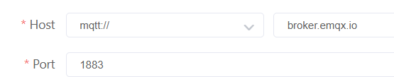
- các thông tin còn lại là tuỳ chỉnh của bản thân 
- bấm connect để kết nối với esp
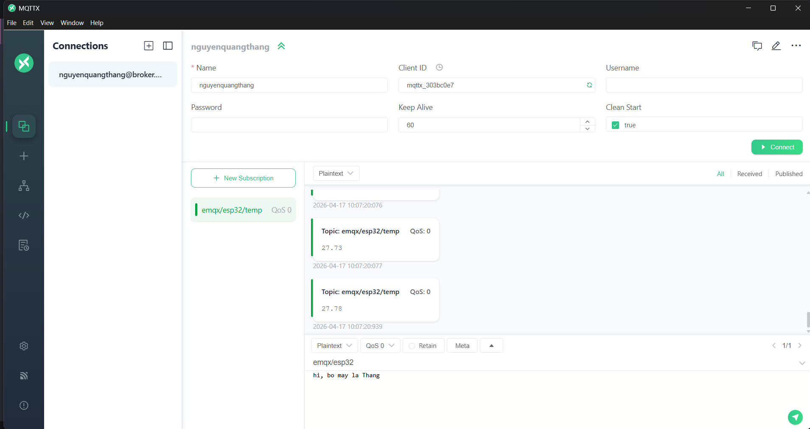
- "new subscription" : đăng kí topic để nhận dữ liệu theo topic
## 6. Tạo giao diện nhận dữ liệu trực tiếp từ broker bằng node-red
- làm theo hướng dẫn trong link https://nodered.org/docs/getting-started/windows
### Cách chạy node-red
- mở cmd gõ "node-red" nhấn enter, lướt xuống để tìm địa chỉ (server now running...)
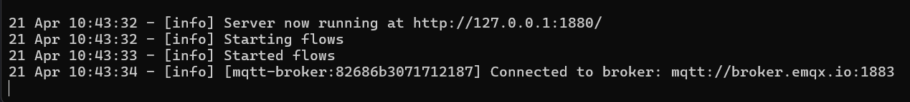
- truy cập địa chỉ ở trên để tạo flow
### Cách tạo flow trên node-red
#### input
- tìm "mqtt in" và kéo vào 
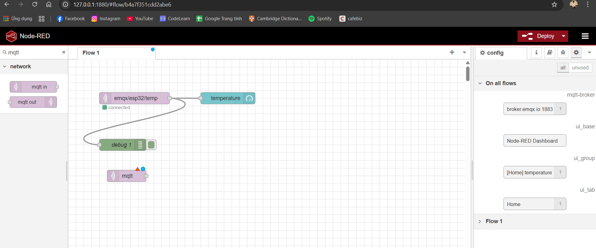
- nhấn đúp vào "mqtt in" để cài đặt 
- chọn server, nếu chưa có server bấm vào dấu cộng
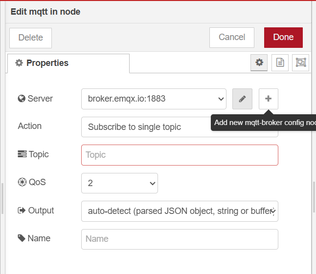
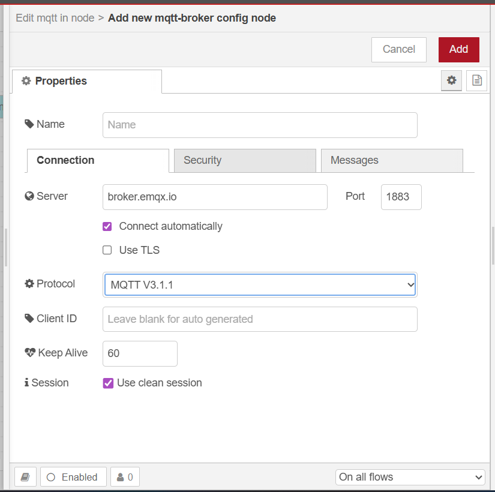
- copy đúng topic và dán vào 
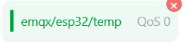
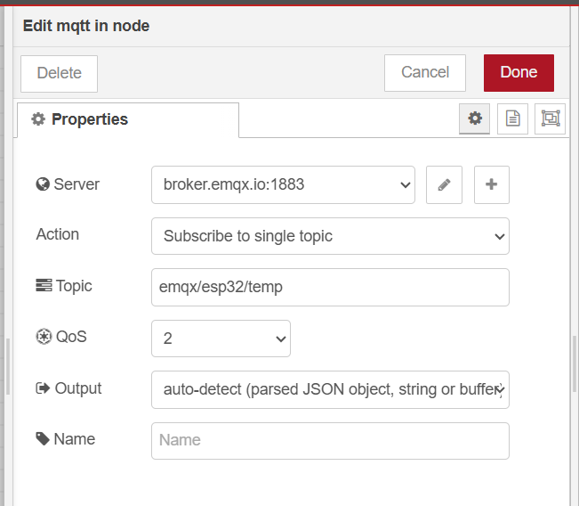
- bấm done
#### output
- lướt xuống dashboard và chọn giao diện tuỳ thích 
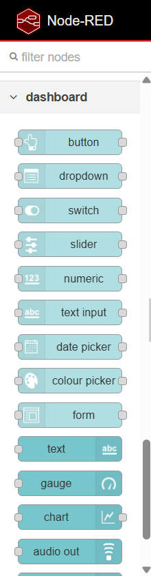
- bấm đúp vào 
- chọn group, nếu chưa có group bấm vào dấu cộng để tạo group
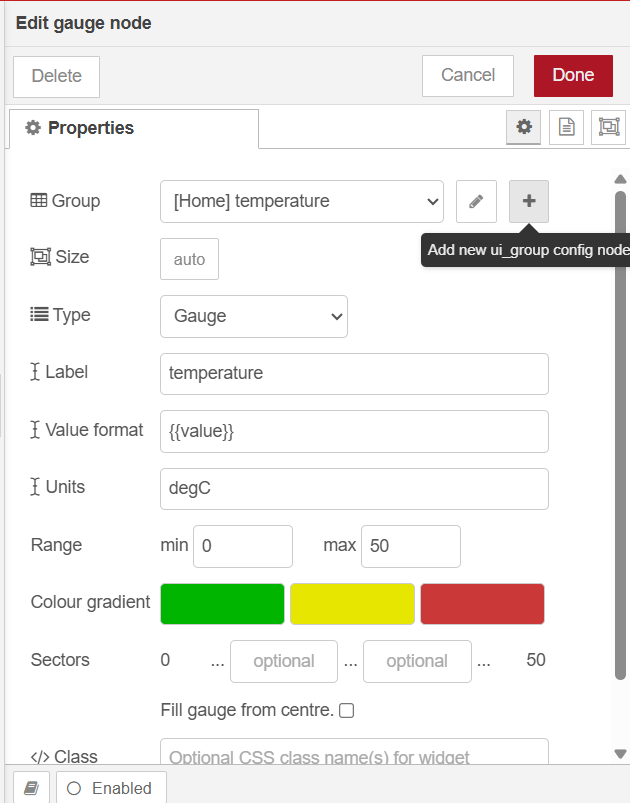
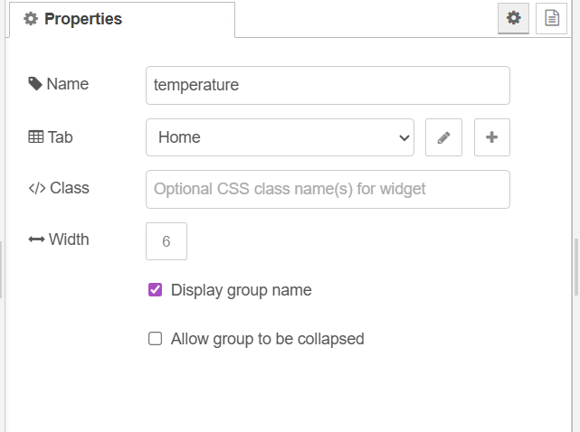
- bấm done
#### nối input với output với nhau 
- bấm deploy 
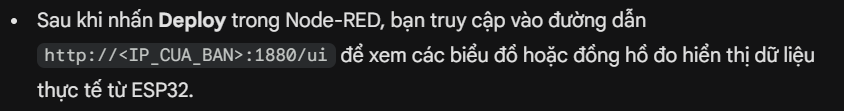

